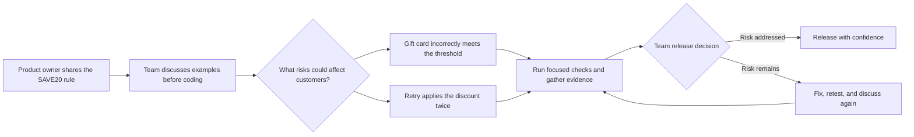

# Agile Testing in Action - Free Workshop Demos

> **One passing example. Two hidden defects. Would you release?**

Follow three short Python demos. A companion video will be published separately on the company YouTube channel and shared on social media. You will see why Agile testers ask questions early, explore risks beyond the happy path, and help the team make a release decision. **No AI model, web app, API key, or server is needed.**

## What are you testing?

[`demos/swiftcart.py`](demos/swiftcart.py) is a **fictional promotion calculator**, the system under test (SUT). It applies the `SAVE20` code to baskets. The three numbered scripts call it with different baskets and print what happened. The calculator contains deliberate defects for you to spot; it is not a production application.

## Follow the three steps

You need **Python 3.10+**. Open a terminal in this repository's folder (the one containing `README.md` and `demos/`). If you downloaded a ZIP, extract it first. Run each command separately:

### 1. Check the business rule

```bash
python3 demos/01_green_is_not_enough.py
```

The £50 basket gets £10 off. But what happens when the basket has £40 of regular items and a £10 gift card? **Ask:** should a gift card count towards the £50 minimum?

### 2. Check a retry

```bash
python3 demos/02_retry_changes_the_risk.py
```

The same basket and code are submitted twice. **Ask:** should a second call increase the discount?

### 3. Discuss the release

```bash
python3 demos/03_release_conversation.py
```

Compare the passing example with the two risky ones. **Ask:** what evidence, impact, and fix would you share with the team before release?

On Windows, replace `python3` with `py -3` in all commands. No packages or accounts are required. The scripts **print the expected defects** rather than crashing; each starts with fresh in-memory data.

## What did you learn?

- **Shift left:** agree on examples like the gift-card rule *before* code is finished, when changes are cheaper.
- **Test by risk:** a valid code is not enough; eligibility and repeated requests can affect customers and revenue.
- **Own quality together:** share evidence and options; release is a team decision, not just a green-test count.

Optional: run `python3 -m unittest discover -s tests -v` (`py -3` on Windows). These tests **confirm the deliberately broken demos remain reproducible**. A green result does **not** mean SwiftCart is correct or safe to release.


### Agile testing as a conversation



## Keep practising

Want to try the decisions yourself? Work through the separate, free [Agile Testing in Action Mini Lab](https://github.com/TestCraft-Academy/agile-testing-in-action-lab) (30–45 minutes) at your own pace. To join a **free, facilitated mini lab**, [register your interest by email](mailto:info@testcraftacademy.com?subject=Free%20Agile%20Testing%20in%20Action%20Mini%20Lab%20interest). Dates and venue have not been confirmed yet; if your organisation could host the lab at its office, please mention that in your message.

For deeper guided practice, explore TestCraft Academy's [Agile Testing in Action course](https://www.testcraftacademy.com/service-page/agile-testing-in-action-course) or [enquire about the course](https://www.testcraftacademy.com/take-a-course-form).

The materials are available under the [MIT Licence](LICENSE).

*Copyright © 2026 TestCraft Academy.*
